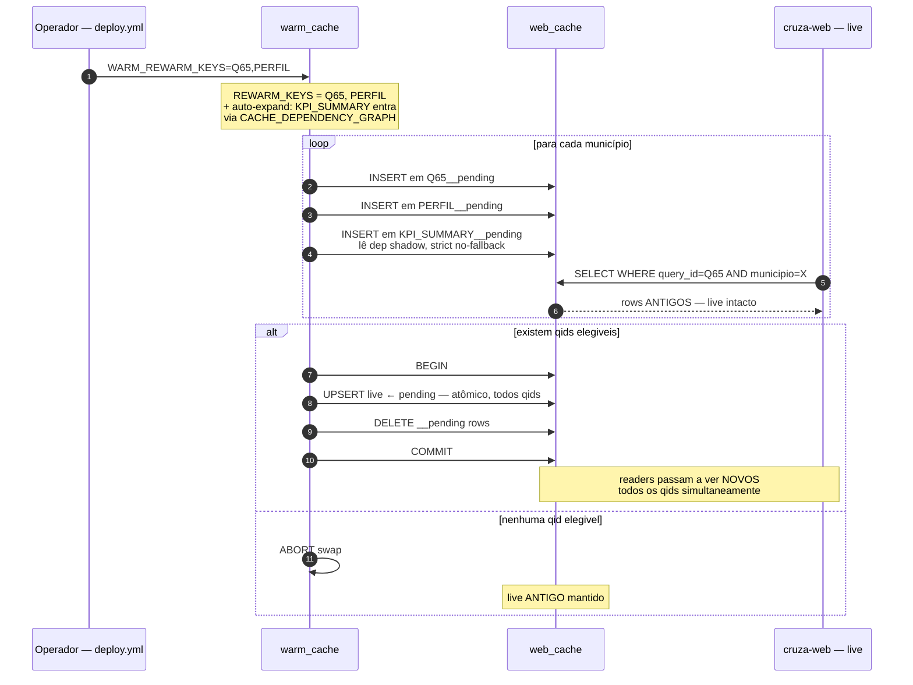

# Cache — `web_cache` + shadow rewarm

Este doc explica o pipeline de cache que sustenta `transparenciapb.org`. Para overview, ver [architecture.md](architecture.md); para operação via deploy, ver [deploy.md](deploy.md).

## Por que cache?

As Q## pesadas (Q65, Q67, Q70, KPI_SUMMARY, PERFIL...) levam de segundos a minutos no Postgres. Em request quente, o `TIMEOUT_PROFILE=3s` de [`web/config.py`](../web/config.py) tornaria essas páginas inviáveis. Solução: **pré-computar tudo offline** e servir HTML SSR lendo apenas de uma tabela. O FastAPI **nunca executa Q## pesada em request síncrono** — só lê `web_cache`.

## Schema da tabela

Definição real em [`web/warm_cache.py:41-51`](../web/warm_cache.py):

```sql
CREATE TABLE IF NOT EXISTS web_cache (
    query_id   TEXT NOT NULL,
    municipio  TEXT NOT NULL,
    columns    JSONB NOT NULL DEFAULT '[]',
    rows       JSONB NOT NULL DEFAULT '[]',
    row_count  INTEGER NOT NULL DEFAULT 0,
    updated_at TIMESTAMPTZ NOT NULL DEFAULT now(),
    PRIMARY KEY (query_id, municipio)
);
```

`query_id` carrega:

- **Q##** literal (ex: `Q65`) — variante all-time.
- **Prefixo temporal** (ex: `ANO:Q65`, `12M:Q65`) — variantes datadas.
- **Sufixo `__pending`** durante shadow rewarm (ver abaixo).
- **Keys especiais:** `PERFIL`, `TOP_FORNECEDORES`, `TOP_SERVIDORES`, `HEATMAP`, `KPI_SUMMARY`, `EMPRESA_PERFIL`, `MAPA_PB` (mapa coropletico da homepage, `municipio=""`).

## Warm cycle

```bash
python -m web.warm_cache --pb              # 1 ciclo: 223 munis PB
python -m web.warm_cache --daemon --loop   # contínuo, pausa de 60s entre ciclos
python -m web.warm_cache --mun "João Pessoa"
```

Configuração relevante:

- `WARM_CACHE_WORKERS=4` (default) — paralelismo de municípios.
- `WARM_WORK_MEM=192MB` por sessão (evita disk-based sorts).
- `WARM_SKIP_RECENT_HOURS=-1` (default) — **skip se já cacheado em qualquer idade**; dados governamentais são estáticos após ETL. Para rebuild forçado, use `drop_cache` ou `invalidate_cache_keys`.
- `TIMEOUT_PROFILE_WARM=600s` (10 min) por empresa em `compute_empresa_perfil_dict` — mega-empresas (BB, Caixa, INSS) têm milhões de empenhos.

## Shadow rewarm — zero downtime



Os comentários canônicos do mecanismo estão em [`web/warm_cache.py`](../web/warm_cache.py).
O swap genérico é atômico **entre as chaves elegíveis**; uma chave com falha pode
ficar de fora. Ele não mantém geração anterior. Não usá-lo para a correção abaixo.

## Perfil por competência: preparação, aprovação e reversão

Procedimento **manual**, primeiro em clone datado. Não é etapa de deploy.
O alvo é o produto de **todo o cadastro não nulo** de `mv_municipio_pb_risco`
por quatro chaves: `ANO:PERFIL`, `12M:PERFIL` e os respectivos `KPI_SUMMARY`.
Nada de `PERFIL` sem prefixo, `drop_cache`, invalidação geral ou `etl_phase=sql`.
O warm genérico **desta versão** não escreve essas quatro chaves, nem em
cron/rebuild com cache miss. Os demais resultados (inclusive all-time)
continuam no ciclo habitual. `TRUNCATE`, invalidações por substring, escritores
antigos e mudanças das fontes não obedecem ao lock deste módulo.
Após alterações nas fontes ou nos TOPs, coordenar nova preparação e aprovação;
o cron genérico não atualiza os quatro resultados publicados.

1. Identificar responsável, SHA do código, snapshot das fontes, horário de
   Brasília, escopo municipal esperado e limites de latência/locks. Confirmar
   que ETL, refresh, warm e reset/invalidação não estão ativos nem serão
   disparados até o fim. O advisory lock do comando serializa **só** outros
   comandos deste módulo. **Não é seguro publicar com o cron ativo.** Sem
   controle da fila e de todos os produtores, não iniciar. Verificar o plano
   com volume representativo, espaço e permissões (incluindo `CREATE TABLE`
   para a inversa). As leituras web já devem ocultar `__pending`.
2. `WARM_REWARM_KEYS=ANO:PERFIL,12M:PERFIL python -m web.cache_perfil_datado preparar`
   escreve só as quatro sombras (`:p1b_ANO_PERFIL`, `:p1b_12M_PERFIL`,
   `:p1b_ANO_KPI_SUMMARY`, `:p1b_12M_KPI_SUMMARY`). Não casam com o reset
   `LIKE '%__pending'`, nem com os prefixos públicos, inclusive no batch
   legado. Exige dependências live presentes (`PERFIL`
   histórico e `TOP_*` dos dois períodos); lista vazia é diferente de chave
   ausente. Não aceita sombra residual: após falha, investigar e, com autorização,
   descartar **apenas** as quatro chaves privadas exatas antes de recomeçar.
   Para não atribuir o período de um perfil novo a TOPs antigos, a preparação
   compara o KPI derivado do cache com o recalculado pelas duas consultas TOP
   nos mesmos dias. Divergência bloqueia o lote; não reescreve os TOPs. Orçar
   também essas leituras (duas por período/município) e a duração até a virada do dia.
   Falha de município ou mudança na baseline não emite manifesto aprovado.
3. Guardar o SHA-256 emitido, dia e limites dos dois períodos. O hash identifica
   os dados, **não certifica a paridade**. Conferir os pares município/chave
   (faltas e sobras), comparar valores e percentuais em sombra com os agregados
   da publicação fixada e o KPI derivado. Conferir janeiro, novembro e o
   controle 2025; no drill de **despesa**, igualar `ano` da rota, verificar
   `ano_arquivo` separadamente e não inferir centavos do HTML. Ensaiar as
   quatro leituras (`/api/perfil`, `/api/kpis`, batch e HTML) em clone e a
   inversa. Não promover com diferença inexplicada ou sem segunda aprovação.
4. `python -m web.cache_perfil_datado promover SHA256_APROVADO` revalida o mesmo
   dia, cadastro, conteúdo das dependências, live e sombras sob lock de escrita
   de `web_cache` (`NOWAIT`; leitores continuam). Salva **na mesma transação**
   a pré-imagem de cada par, inclusive ausência, e a imagem publicada em
   `web_cache_perfil_reversao`, fora da tabela servida. Só então promove o
   conjunto. A tabela de reversão não pode preexistir. O hash inclui timestamps:
   até a reescrita do mesmo valor pede nova conferência. Se o custo de hash/lock
   não couber no orçamento em clone, não liberar. Requests com vários SELECTs
   podem atravessar o commit; a atomicidade é da geração no banco.
5. Se necessário e autorizado, `python -m web.cache_perfil_datado reverter SHA256_APROVADO`.
   Mesmo em outro dia, verifica a pós-imagem **e** a assinatura das cinco
   dependências por município do escopo original, antes de qualquer escrita.
   Restaura os valores e
   timestamps anteriores e remove só pares que antes não existiam. Se outra
   escrita interveio, parar e reconciliar, não forçar. Após estabilização,
   arquivar a tabela de inversa com acesso restrito, verificar restauração e
   só então liberar o nome para outra geração. **Reverter código não restaura
   cache**. A inversa restaura as linhas, não o comportamento dos binários antigos.

**Compatibilidade e ordem de exposição.** Preparar e revisar a sombra fora do
tráfego com os escritores parados. Coordenar aprovação, promoção e troca dos
leitores; se não for possível separar código instalado de código servindo
tráfego, exigir janela de manutenção. Não há promessa de zero downtime: o
novo SSR e as APIs datadas recusam (`503`) fotos legadas sem limites comprovados,
inclusive depois de uma inversa para o legado. Manter a versão anterior do
leitor disponível para esse rollback. All-time explícito continua disponível.
O batch omite só `PERFIL`/`KPI_SUMMARY` quando não são do preset solicitado;
as demais chaves mantêm o contrato legado. Em cache miss/CUSTOM a SQL pública
só lê as tabelas financeiras se houver um perfil datado publicado **daquele
município**; somente a preparação pode calculá-lo antes disso. Se ambos os
perfis forem invalidados será necessária nova publicação. Revalidar também as
rotas com os consumidores e limites de latência do clone antes de expor.

O readiness do manifesto estático não cobre esta transição. Antes de abrir
tráfego no leitor novo, exigir 200 no HTML de cidade, perfil, KPIs e batch e
conferir o intervalo e os indicadores nas quatro respostas. Ensaiar também
o dia seguinte ao da foto: o intervalo congelado vira `CUSTOM` e a abertura
pode trocar uma leitura em lote por chamadas por painel. Medir a latência
e o custo no clone; não chamar essas chaves de “até hoje” para ganhar cache.
Na inversa, não reabrir o tráfego com o leitor novo sobre as linhas legadas.

Para repetir o teste offline, usar PG16 descartável com `listen_addresses=''`,
socket único em diretório privado, porta de socket `54160`, usuário `p1b_teste`,
base `p1b_test` e `P1B_TEST_SOCKET` apontando para esse diretório. Executar
`python -m pytest -q tests/test_perfil_competencia.py` e parar o cluster ao fim.
As fixtures não chamam o site. Exercitam os workers e o caminho de cron
somente no schema sintético desse socket.

## 3 modos de atualização

| Modo | Operação | Downtime | Quando usar |
|---|---|---|---|
| **`drop_cache=true`** | `TRUNCATE web_cache` | **12-18h** (cache miss em TUDO até warm completar) | Mudança de schema, big rebuild |
| **`invalidate_cache_keys=Q65,PERFIL`** | `DELETE` cirúrgico HARD por **substring** (`LIKE '%termo%'`) | Cache miss até warm rebuildar essas chaves | Dados live **broken** (bug produziu lixo, precisa sumir já). Cuidado: `PERFIL` casa também `EMPRESA_PERFIL`, `PERFIL_DATED`, etc. |
| **`rewarm_cache_keys=Q65,PERFIL`** | Shadow rewarm + swap atômico | **Zero** | **Default recomendado** para atualizar dados |

## Auto-expansão

Quando você passa `rewarm_cache_keys=PERFIL`, o sistema **automaticamente** coloca em shadow qualquer **derived** que dependa de PERFIL no mesmo prefixo. Definido em `CACHE_DEPENDENCY_GRAPH` ([`web/warm_cache.py:193-195`](../web/warm_cache.py)):

```python
CACHE_DEPENDENCY_GRAPH = {
    "KPI_SUMMARY": ["PERFIL", "TOP_FORNECEDORES", "TOP_SERVIDORES"],
}
```

Sem isso, `KPI_SUMMARY` continuaria sendo computado lendo `PERFIL` **velho** do live durante o warm, e o swap deixaria o UI inconsistente.

## Match semantics

Match é **exato**, não substring. Padrão casa com:

- **`query_id` literal** (ex: `ANO:Q65` casa só `ANO:Q65`).
- **`base`** (qid sem prefixo): `Q65` casa `Q65`, `ANO:Q65`, `12M:Q65`.

```text
rewarm_cache_keys = "PERFIL"
✅ casa: PERFIL, ANO:PERFIL, 12M:PERFIL
❌ NÃO casa: EMPRESA_PERFIL  (base inteira é EMPRESA_PERFIL)
```

Decisão de design (PR #105 review): evitar que `PERFIL` dispare warm de ~143K empresas via `EMPRESA_PERFIL`. Use prefixos explícitos para escopar (`ANO:Q65` ≠ `Q65`).

## Endpoint admin

```bash
curl -X POST https://transparenciapb.org/api/cache/invalidate \
     -H "X-Admin-Token: $CACHE_INVALIDATE_TOKEN" \
     -H "Content-Type: application/json" \
     -d '{"prefix": "Q65"}'
```

- Implementado em [`web/routes/cidade.py:1406-1430`](../web/routes/cidade.py) (PR #118).
- **Fail-closed:** sem `CACHE_INVALIDATE_TOKEN` no `.env`, endpoint responde 503.
- Em **produção**, prefira o workflow `deploy.yml` (auditável, gera log, integrado ao rewarm).

## Caveats

- **Swap exige `fail == 0`** para essa qid. Uma única falha em qualquer município aborta o swap dessa qid; rows `__pending` ficam até o próximo deploy executar a etapa "Reset shadow rows".
- **Atomicidade do swap genérico:** erro durante a transação desfaz todos os seus UPSERTs. Falha ocorrida **antes**, no preparo, só tira a qid afetada da lista elegível.
- **Sem TTL automático:** cache não expira sozinho. Refresh acontece quando `deploy.yml` é executado com `rewarm_cache_keys`. Não há cron de rewarm automático (ainda).
- **`web_cache` cresce com dated:** cada Q## com `sql_full_dated` registra pelo menos all-time + ano-atual (`ANO:`), dobrando linhas. PB: ~223 munis × N queries × 2 variantes.
- **Cobertura mínima 80%** antes de `expose_empresa_sitemap=enable` no deploy — gate manual no `deploy.yml`.
- **Shadow rows persistem entre deploys?** Não. O step "Reset shadow rows" do `deploy.yml` deleta `*__pending` no início de cada deploy, evitando shadow stale quando o SQL mudou entre runs.

## Cleanup de entries órfãs (`cleanup_orphan_empresa_cache`)

Entries órfãs surgem quando o ETL normalize remove dados-fonte que sustentavam uma empresa (caso típico: contaminação por CPF padded — ver [ADR-0007](adr/0007-etl-normalize-fix.md)). Após `REFRESH MATERIALIZED VIEW CONCURRENTLY mv_empresa_pb`, a MV fica limpa, mas `web_cache` mantém entries antigas para CNPJs não mais qualificados — o warm cycle só faz UPSERT sobre **empresas qualificadas atuais**, nunca toca órfãs.

**Sintoma**: páginas `/empresa/<cnpj>/<slug>` órfãs servem KPIs do cache stale (R$ X mil, N empenhos) enquanto a tabela live retorna "Nenhum empenho disponível".

**Fix**: função standalone `cleanup_orphan_empresa_cache` em [`web/warm_cache.py`](../web/warm_cache.py) faz hard DELETE em batches via `ctid` das entries `EMPRESA_PERFIL` + `EMPRESA_PERFIL_MUN` onde `substring(municipio, 1, 8) NOT IN mv_empresa_pb.cnpj_basico`:

```bash
# Dry-run: conta sem deletar
python -m web.warm_cache --cleanup-orphan-empresa --dry-run

# Live: DELETE em batches de 5000 (default)
python -m web.warm_cache --cleanup-orphan-empresa
```

Via deploy:

```bash
gh workflow run deploy.yml -f etl_phase=web -f cleanup_orphan_empresa_cache=true
```

**Não dispara warm cycle** — standalone, ~1-5 min em prod. URLs órfãs viram cache miss → **404 Not Found** (a rota `/empresa/<cnpj>` retorna 404 em cache miss desde a mudança que acompanhou ADR-0009/ADR-0007). Google de-indexa em ~7-30 dias (vs semanas/meses se fosse 503 transient). Sitemap regenera natural só com qualifying da MV.

**Shards de sitemap past-end** (ex: `/sitemap-empresas-municipios-9.xml` quando só existem 7 shards reais pós-cleanup) retornam **410 Gone** desde o fix do encolhimento MV. Antes retornavam `<urlset></urlset>` HTTP 200 — válido para sitemap.org mas Google Search Console acusava "Tag XML ausente" e mantinha shard no índice histórico. Implementado em [`web/routes/seo.py`](../web/routes/seo.py) para `/sitemap-empresas-{n}` e `/sitemap-empresas-municipios-{n}`. Licitações fica de fora porque count lê de `web_cache` (oscila durante warm) — manter urlset vazio é safe enquanto warm popula.

Use **após** `run_normalize_fix=true` + `refresh_mvs=mv_empresa_pb` (que removeram empresas contaminadas). Idempotente. Ver [ADR-0009](adr/0009-orphan-empresa-cache-cleanup.md) para racional completo (alternativas avaliadas, trade-offs).

## Operações em produção

A receita operacional canônica (mudou SQL de uma query → quero atualizar cache sem downtime):

1. PR com a nova SQL.
2. Após merge, dispare `deploy.yml` com `rewarm_cache_keys=Q65,PERFIL` (vírgula separa múltiplas). Para mudanças no painel de servidores, use `rewarm_cache_keys=TOP_SERVIDORES`; a auto-expansão inclui `KPI_SUMMARY`. Se o deploy também precisar de `etl_phase=sql` mas só uma key conhecida mudou, passe `warm_skip_hours=-1` para evitar rebuild live completo e deixar só o shadow rewarm recalcular a key.
3. Workflow:
   - Sincroniza código.
   - Reseta shadow rows (`DELETE WHERE query_id LIKE '%__pending'`).
   - Roda `WARM_REWARM_KEYS=Q65,PERFIL python -m web.warm_cache --pb`.
   - Se fail==0: swap atômico. UI nunca viu cache stale.
   - Se fail>0: aborta swap; cache live antigo permanece servindo.

Detalhes completos dos inputs em [deploy.md](deploy.md).

## Relacionados

- [architecture.md](architecture.md) — sequence diagram shadow rewarm em alto nível.
- [mv-guide.md](mv-guide.md) — mudou MV? Rewarm das Q## que a consomem.
- [queries-guide.md](queries-guide.md) — registrar a query é pré-requisito para o warmer encontrá-la.
- [web-guide.md](web-guide.md) — rotas cache-only (503 se miss) vs live fallback.
- Sample dump da tabela (uma vez disponível): `docs/sample-data.md`.
