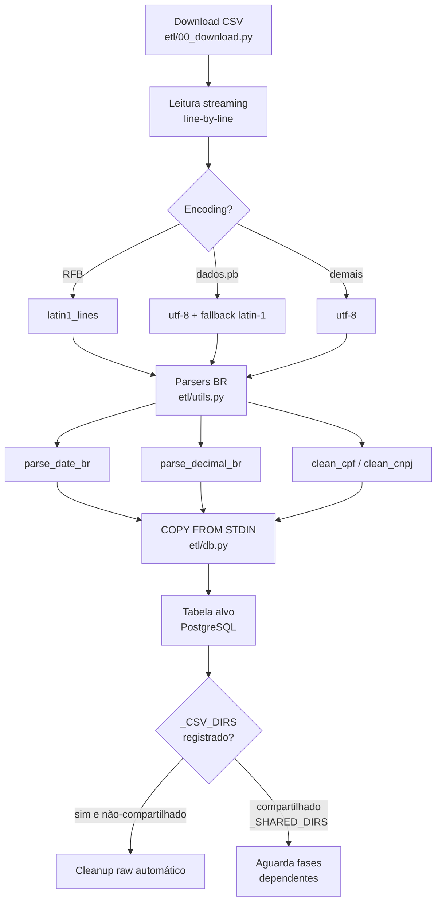

# Guia ETL Clássico — Como adicionar uma fase

Este guia descreve como **adicionar uma nova fase ao ETL clássico** do
`govbr-cruza-dados`. Para o framework **incremental** (append-only com
watermark, DLQ e role-segregação) veja [etl-incremental-guide.md](etl-incremental-guide.md).

## O que é o ETL clássico

O ETL clássico é um pipeline de **full reload**: cada fase tipicamente faz
`TRUNCATE` da(s) sua(s) tabela(s)-alvo e reconstrói tudo a partir dos CSVs
brutos baixados em `$DATA_DIR/<fonte>/`. As 24 fases vivem hardcoded na lista
`phases` de [`etl/run_all.py`](../etl/run_all.py) e são executadas na ordem em
que aparecem — a posição importa porque fases tardias dependem de tabelas,
colunas normalizadas (`cpf_digitos`, `cpf_cnpj_norm`) e índices criados por
fases anteriores. Ver [architecture.md](architecture.md) para o panorama geral
e o lugar do clássico dentro do projeto.

**Quando escolher clássico vs incremental?**

| Escolha clássico se… | Escolha incremental se… |
|---|---|
| Fonte publica snapshot full periódico (ex: RFB CNPJ mensal) | Fonte é append-only com janelas mês/ano (ex: Dados-PB pagamento_YYYY_MM.csv) |
| Não há **natural key** estável | Há NK estável e perdê-la corromperia dados |
| Histórico pode ser regenerado do zero | Preservação histórica é requisito |
| Volume cabe em rebuild noturno | Volume exige carga delta + idempotência |

A regra prática: se você fizer `TRUNCATE` e re-`COPY` for aceitável, é
clássico. Se não, leia o [etl-incremental-guide.md](etl-incremental-guide.md).

Convenções não-negociáveis (sem pandas, streaming, `COPY FROM STDIN`) estão
registradas em [adr/0001-no-pandas.md](adr/0001-no-pandas.md) — leia antes de
mandar PR.

## Fluxo de uma fase ETL clássica



## Anatomia de uma fase

Toda fase é um módulo Python em `etl/NN_<nome>.py` que expõe **uma função
`run() -> None`** — o orquestrador a chama via `importlib`.

```python
# etl/NN_minha_fonte.py
import logging
from etl.config import DATA_DIR
from etl.db import get_conn, copy_csv_streaming, truncate_table
from etl.utils import latin1_lines, parse_date_br, parse_decimal_br, clean_cnpj

log = logging.getLogger(__name__)

def run() -> None:
    with get_conn() as conn:
        truncate_table(conn, "minha_tabela")
        # ... streaming + COPY ...
        conn.commit()
```

### Helpers obrigatórios

**`etl/db.py`** (use sempre — pool gerenciado, retries, COPY tuning):

- `get_conn()` — context manager, devolve conexão do pool.
- `copy_from_stream(conn, table, columns, stream)` — `COPY FROM STDIN` a partir
  de um iterável de linhas TSV.
- `copy_csv_streaming(conn, table, columns, csv_path, ...)` — wrapper para
  arquivos CSV grandes, sem materializar em memória.
- `batch_insert(conn, table, columns, rows)` — fallback para volumes
  pequenos (< 10k linhas).
- `execute_sql_file(conn, "NN_schema.sql")` — executa arquivo de `sql/`.
- `truncate_table(conn, "tabela")` — padrão de início de fase clássica.

**`etl/utils.py`** (parsers BR — reuse, não reimplemente):

- `parse_date_br("31/12/2023")` → `date(2023, 12, 31)`. Aceita também
  `2023-12-31` (ISO) e variantes com timestamp.
- `parse_decimal_br("1.234,56")` → `Decimal("1234.56")`.
- `clean_cpf` / `clean_cnpj` — remove pontuação, valida tamanho.
- `extract_cpf_masked("***123456**")` → 6 dígitos do meio (padrão Portal
  Transparência, ver [glossario.md](glossario.md)).
- `normalize_name` — uppercase, sem acentos, espaços colapsados.
- `latin1_lines(path)` — gerador de linhas para RFB (latin-1 obrigatório, ver
  `RFB_ENCODING` em `etl/config.py`).

### Encoding por fonte

| Fonte | Encoding | Helper |
|---|---|---|
| RFB (Receita Federal) | **latin-1** | `latin1_lines` |
| dados.pb (estadual) | utf-8 com fallback latin-1 | `open(..., encoding="utf-8", errors="replace")` |
| TCE-PB, Portal Transparência, PNCP, demais | utf-8 | `open(..., encoding="utf-8")` |

> **Caveat real:** misturar encodings causa `UnicodeDecodeError` silencioso
> quando rodando dentro de `copy_csv_streaming`. Sempre teste com `head -1` do
> CSV bruto antes de assumir utf-8.

## Passo a passo: adicionar uma fase nova

1. **Criar o módulo** `etl/NN_minha_fonte.py` com `def run() -> None`. Use `NN`
   na posição lógica (depois das deps, antes dos consumidores).

2. **Criar o DDL** em `sql/NN_schema_minha_fonte.sql`. Use `CREATE TABLE IF
   NOT EXISTS` + `CREATE INDEX` separados (não inline em CREATE TABLE — eles
   vão para `sql/11_indices.sql`).

3. **Decidir onde o schema roda:**
   - **Early** — adicionar `execute_sql_file(conn, "NN_schema_minha_fonte.sql")`
     em `etl/01_schema.py`. Padrão para tabelas que outras fases consomem.
   - **Late** — executar o SQL na própria `run()` da fase. Use quando a tabela
     for autocontida.
   Documente a decisão no docstring do módulo.

4. **Registrar na lista `phases`** dentro da função `main()` de `etl/run_all.py:76-101` (lista local hardcoded — a posição
   define a ordem de execução):

   ```python
   ("Fase NN: Minha Fonte", "etl.NN_minha_fonte"),
   ```

5. **Adicionar o download** em `etl/00_download.py` se for fonte externa.
   Use os helpers de download existentes (com retry e progress).

6. **Cleanup de CSV bruto.** Registre em `_CSV_DIRS` (top de `etl/run_all.py`):

   ```python
   _CSV_DIRS = {
       ...
       "etl.NN_minha_fonte": ["minha_fonte"],
   }
   ```

   Se você reutiliza um diretório raw já consumido por outra fase (ex: `rfb/`,
   `tse/`), **adicione também em `_SHARED_DIRS`** — caso contrário a primeira
   fase a terminar deletará os CSVs antes da sua rodar.

7. **Normalização CPF/CNPJ.** Se sua tabela tem coluna CPF/CNPJ, adicione a
   normalização em `etl/15_normalizar.py` (executada na **fase 17**). Essa
   fase cria as colunas `cpf_digitos` (6) e `cpf_cnpj_norm` (14) usadas por
   **todas** as queries cross-source (Q01–Q310). Sem isso, joins viram
   `LIKE/regex` e a query timeouta.

8. **Índices.** Se a tabela alimenta MV (`mv_municipio_pb_risco`,
   `mv_empresa_pb`, etc — ver [architecture.md](architecture.md) layer L1/L2)
   ou queries Q##:
   - Índices gerais → `sql/11_indices.sql`
   - Índices Q##-específicos → `sql/19_indices_queries.sql`

9. **Atualizar contagem** "24 fases" → "25 fases" no `README.md` raiz e em
   `.github/workflows/deploy.yml` (input `etl_phase`).

## Convenções não-negociáveis

Ver [adr/0001-no-pandas.md](adr/0001-no-pandas.md) para o racional completo.

- **Sem pandas.** Box-alvo tem 16GB RAM; DataFrames não cabem em 350M linhas.
  Sempre streaming + `COPY FROM STDIN`.
- **Sem `executemany`** para volumes > 10k linhas — use `COPY`. `batch_insert`
  só para tabelas de domínio (CNAEs, motivos, etc).
- **Sempre `with get_conn() as conn:`** — o pool gerencia conexões; criar
  `psycopg2.connect` direto vaza handles.
- **Logging via `logging` module**, não `print`. Código novo que usa `print`
  será rejeitado em review (ver issue #136).
- **Idempotência explícita.** Declare no docstring qual padrão você usa:
  - `TRUNCATE + rebuild` (padrão clássico), ou
  - `INSERT ... ON CONFLICT DO NOTHING` (raro no clássico, padrão no
    incremental — ver [etl-incremental-guide.md](etl-incremental-guide.md)).

## Exemplo concreto

```python
# etl/NN_minha_fonte.py
"""Carga full-reload da fonte 'Minha Fonte' (CSV anual, latin-1).

Padrão: TRUNCATE + COPY FROM STDIN.
"""
import logging
from etl.config import DATA_DIR
from etl.db import get_conn, copy_from_stream, truncate_table
from etl.utils import latin1_lines, parse_date_br, parse_decimal_br, clean_cnpj

log = logging.getLogger(__name__)

COLUMNS = ["cnpj", "data_emissao", "valor", "descricao"]

def _rows(csv_path):
    for i, line in enumerate(latin1_lines(csv_path)):
        if i == 0:
            continue  # header
        cnpj_raw, data_raw, valor_raw, desc = line.rstrip("\n").split(";")
        yield (
            clean_cnpj(cnpj_raw),
            parse_date_br(data_raw),
            parse_decimal_br(valor_raw),
            desc.strip(),
        )

def run() -> None:
    src_dir = DATA_DIR / "minha_fonte"
    with get_conn() as conn:
        truncate_table(conn, "minha_tabela")
        for csv in sorted(src_dir.glob("*.csv")):
            log.info("Carregando %s", csv.name)
            tsv = (
                "\t".join("" if v is None else str(v) for v in row) + "\n"
                for row in _rows(csv)
            )
            copy_from_stream(conn, "minha_tabela", COLUMNS, tsv)
        conn.commit()
    log.info("Fase concluída")
```

## Caveats conhecidos

- **`_CSV_DIRS` vs `_SHARED_DIRS`.** O cleanup automático em `_cleanup_csvs`
  (`etl/run_all.py:55-68`) deleta o raw após a primeira fase que o consome
  *succeed*. Se sua fase nova consome `rfb/` mas você não adicionou ao
  `_SHARED_DIRS`, a fase 3 (`etl.03_rfb`) deleta o CSV antes da sua rodar.
- **Fase 17 (`etl.15_normalizar`) cria `cpf_digitos`/`cpf_cnpj_norm`** usadas
  por todas as queries cross-source. Esquecer de adicionar sua tabela ali
  quebra joins downstream silenciosamente (query simplesmente retorna 0 linhas
  ao invés de erro).
- **Erros silenciosos em `etl/15_normalizar.py:_exec`** — a função engole
  exceções de `CREATE INDEX`, então uma fase pode "concluir" com índice
  faltando. Sempre verifique `\d+ <tabela>` no psql após mudar normalização.
- **`cnpj_basico` requer EXISTS guard contra `estabelecimento` + extração de `cpf_digitos` via DV check.** Quando o
  documento original (`cpf_cnpj`, `cpfcnpj_credor`, etc) tem 14 caracteres,
  o ETL faz `cnpj_basico = LEFT(doc, 8) WHERE EXISTS estabelecimento`. CPFs
  (11 dígitos) vêm armazenados com padding de zeros à esquerda — `LEFT(..., 8)`
  desses colidiria com `cnpj_basico` de PJ real (PR #151/#153/#156 fix).
  Desde a Fase 5/7 de `etl.15_normalizar` (versão pós-PR feat/etl-cnpj-basico-fix),
  todos os `UPDATE cnpj_basico` validam via `AND EXISTS (SELECT 1 FROM
  estabelecimento WHERE cnpj_completo = doc)`. Fase 9 nova faz cleanup
  retroativo + extrai `cpf_digitos` via DV check matemático (funções
  `is_valid_cpf()`/`is_valid_cnpj()` com módulo 11 oficial RFB). Garantia:
  MEIs/CNPJs reais não-sincronizados (DV CNPJ válido) **nunca** viram
  "CPF sintético" — ficam aguardando RFB sync e ETL idempotente popula
  retroativamente. Veja [`docs/adr/0007`](adr/0007-etl-normalize-fix.md).
- **`run_all` continua após falha de fase.** Cada fase é envolvida em
  try/except — uma falha não aborta o pipeline. Verifique os logs (e o
  resumo `_emit_notice` no GitHub Actions) ao final.

## Sync mensal RFB

A fase 3 (`etl.03_rfb`) só faz a **carga inicial**: pula tabelas já populadas
e usa `ON CONFLICT DO NOTHING`, então nunca atualiza situação cadastral,
razão social, empresas novas nem sócios. A atualização mensal é feita por
[`etl/rfb_sync.py`](../etl/rfb_sync.py) (o framework incremental não serve: a
RFB publica snapshot completo e o sync precisa de UPDATE/DELETE, proibidos
pelo P2). As conversões de coluna são compartilhadas com a fase 3 em
[`etl/rfb_common.py`](../etl/rfb_common.py).

**Contrato prospectivo — rollout bloqueado.** A configuração do [agendador e
deploy](deploy.md#sync-mensal-rfb) não muda. O procedimento abaixo descreve
o comportamento do código; não autoriza acionar a carga, usar `:force` ou reparar a base.

1. **Pré-validação:** carrega os 37 ZIPs, prepara as quatro stagings tipadas e
   testa os seis domínios (estrutura, tipos, PK, volume) antes de aplicar
   `empresa`. `--tables` limita a escrita, não o conjunto validado. Nesse
   ponto só há escritas de staging e de suporte/auditoria. Snapshot vazio,
   remoção excessiva, conflito de sócio ou último domínio inválido não deixam
   lotes de negócio aplicados. Nas tabelas com PK, inclusive entre ZIPs,
   só se aceita repetição comprovada pelos mesmos bytes do registro e campos
   tipados; payload divergente para a mesma chave aborta. Erros de
   leitura/conversão também interrompem.
2. **Aplicação:** `empresa` → `estabelecimento` → `simples` → `socio`, em
   transações por prefixo de `cnpj_basico`. Para cada tabela aplicada, compara
   a live à staging **nos dois sentidos** antes de prosseguir. Nas tabelas com
   PK permanece a exceção pré-existente de registro incompleto: preservar o
   existente, não inserir o novo e contabilizar `incompletas_ignoradas`.
   Os domínios só são substituídos no escopo completo, numa transação.
3. **Publicação do sync:** só com as quatro tabelas, domínios e refresh habilitado.
   Religa os CNPJs do delta, purga o cache dos estabelecimentos removidos e
   atualiza L1 → auxiliares → L2 e sitemap. Os destinos de relink, o delta e
   `web_cache` (incluindo as colunas utilizadas) são obrigatórios: o sync
   integral confere o catálogo antes do primeiro lote e novamente antes do
   relink, mesmo com delta vazio. Ausência de MV prevista também é falha.
   O delta só é baixado na transação que registra o `success` final. Esse
   sucesso é do **sync RFB**, não do aquecimento externo do cache/site.

**Sócios:** a identidade é a tupla completa
`(cnpj_basico, tipo_socio, nome, cpf_cnpj_socio, qualificacao, dt_entrada)`;
o MD5 auxilia a busca, não substitui a comparação dos campos (inclusive nulos).
Uma ocorrência descartada da origem exige o mesmo SHA-256 dos bytes do registro
CSV e os mesmos campos tipados na staging; repetições comprovadas ficam em
`repeticoes_identicas`. A igualdade após conversão, sozinha, não basta.
O hash usa os bytes crus; para o parser, CR, CRLF e LF continuam virando LF,
inclusive dentro de campo entre aspas, como na carga clássica.
Antes do primeiro lote, `identidades_multiplas_live > 0` recusa a aplicação,
inclusive se a identidade sairia do snapshot ou se uma falta compensar a sobra.
Isso **não** transforma troca legítima de vínculos entre meses em erro: faltas
e saídas únicas são planejadas separadamente. Depois dos lotes, comparam-se
multiplicidades dos registros completos (identidade **e** atributos) e as
inserções/saídas efetivas com o plano. Não há tolerância `+27` nem lista de ids
para exclusão deduzida do saldo.
Mudança de `faixa_etaria`/representante/país atualiza in-place; vínculo que
some do snapshot é **movido** para `socio_historico` (`id` original + chave própria `hist_id`, com
`removido_em`/`rfb_mes_removido`). `socio` continua significando "sócio
atual" para todas as queries; para análises "era sócio quando recebeu", una
`socio` com `socio_historico`. O histórico começa no primeiro sync — não há
dados de saídas anteriores.

**Saídas e auditoria**

| Saída | Significado |
|---|---|
| `0`, `synced` ou `skipped` | Sync integral confirmado ou competência já confirmada, sem aplicação nova pendente. |
| `1` | Falha; se `stats.aplicacao_iniciada`, pode haver commits de negócio. Não equivale a rollback do mês. |
| `2` | Recusa por guarda/pré-condição, antes da aplicação desta tentativa. |
| `3`, `publicacao_pendente` | `--tables` parcial ou `--no-refresh`: escopo solicitado aplicado, **sem** relink, purga, refresh ou avanço do último sucesso. |

Após o primeiro sucesso integral, só se aceita o mesmo mês ou seu sucessor
imediato (inclusive dezembro → janeiro). `latest` e `--force` não atravessam
uma lacuna: uma saída seguida de reingresso ficaria invisível no histórico.
Uma tentativa nova que entrou em aplicação bloqueia outra competência e os
hooks de refresh RFB, TCE-PB e Bolsa Família até a confirmação integral. O
lock de sessão cobre o hook inteiro, inclusive seus commits; sem log RFB
o hook incremental adquire o lock e segue sem criar esquema. O retry não
pula trabalho por causa de um `success` anterior à pendência. O contrato
histórico de leitura do log é preservado: sucessos legados sem marcador de
tabelas parciais continuam sendo considerados; não se exige evidência nova
retroativamente nem se declara que esses runs foram revalidados.

**Falha após commit:** o último lote da tabela grava atomicamente
`stats.paridade_nao_confirmada`; só a pós-condição bem-sucedida libera essa
barreira. Se a comparação divergir ou sua confirmação for interrompida, a
retomada automática é **recusada**, mesmo com manifesto igual, mesmo com
`--force` e mesmo após remover a causa da divergência. Comparar novamente
contra uma live corrompida poderia arquivar uma saída que nunca existiu.
Exige conciliação e decisão humana em clone; não apagar o marcador para
destravar. Falhas operacionais antes dessa fronteira ou no refresh continuam
elegíveis à retomada sob os guards de competência e manifesto. `failed`
sozinho não distingue os casos; consultar `stats.classe_falha` e o marcador.

```sql
-- Últimas execuções, contagens por tabela e motivo de falha/guard
SELECT id, rfb_mes, status, iniciado_em, finalizado_em, erro, stats
FROM rfb_sync_log ORDER BY id DESC LIMIT 5;
```

**Condições para liberar, ainda não atendidas:**

- **Custo e evidência em clone:** as comparações substituem as contagens
  anteriores (uma leitura lógica da live no plano e outra na pós-condição de
  cada tabela aplicada, além do diff). Não se acrescenta censo nacional ao
  fim nem índice `UNIQUE` em `socio`; agrupar registros largos ainda pode ser
  caro. As quatro stagings agora coexistem. Medir `EXPLAIN (ANALYZE, BUFFERS)`,
  I/O, temporários, disco **do PostgreSQL** e duração em clone representativo.
  `--min-free-gb` no diretório de download não garante esse espaço.
- **Origem e baseline:** `stats.manifesto` fixa SHA-256 e bytes de cada ZIP
  e de seu membro CSV antes da primeira escrita. Se uma aplicação anterior
  ficou pendente, a retomada exige o mesmo manifesto integral, mesmo com
  `--force`. Hashes não substituem o arquivamento autorizado dos objetos nem
  a verificação de que a baseline da live não mudou entre tentativas. Conciliar por prefixo
  a origem, atributos, multiplicidade, ids atuais, histórico e controles em
  réplica/clone, sem publicar dados individuais. Orçar também o SHA-256 por
  registro e a coluna de assinatura nas quatro stagings.
- **Recuperação e exposição:** o marcador conservador de início não é um
  diário transacional por lote. Leitores diretos podem ver lotes comitados;
  o relink/purga e as MVs tampouco trocam todos de geração atomicamente.
  O lock coordena o sync e os três hooks, não SQL avulso, cargas das outras
  fontes, aquecimento do cache ou todo escritor externo. Exigir
  recuperação demonstrada com pré-imagem, mesmo manifesto, ausência de
  escritor concorrente, competências contíguas e controle das rotas/cache
  antes de qualquer canário. Não usar retry, mês posterior ou `--force` como
  diagnóstico em produção. Nenhuma agenda é pausada por este documento.

## Como testar localmente

Sem suite automatizada para o ETL clássico (ver seção abaixo). Smoke tests:

```bash
# Sintaxe — sempre rode antes de commit
python -m compileall etl -q

# Fase isolada (sem rodar as 24)
python -m etl.NN_minha_fonte

# Resume a partir da sua fase
python -m etl.run_all NN

# Validar contagem após carga
psql -c "SELECT count(*) FROM minha_tabela"
```

Para testar com subset de dados, coloque manualmente alguns CSVs em
`$DATA_DIR/minha_fonte/` antes de rodar a fase — pule o `etl.00_download`.

## Testes

O ETL clássico **não tem suite automatizada** hoje — fases novas não bloqueiam
por testes. A suite existente (`tests/incremental/`) cobre apenas o framework
incremental. Exceção: o sync RFB tem `tests/test_rfb_sync.py` (unitários sempre;
integração com `TEST_RFB_DSN` apontando para um banco descartável com `test`
no nome — o fixture recria as tabelas RFB). Se você quiser adicionar testes, modele em cima de
`tests/incremental/test_*.py` mas note que rodá-los exige Postgres com
migrations 22–29+32+34+35 + role `etl_incremental`.

A validação real acontece em produção via:
- Contagens de linha por tabela (logged no fim de cada fase)
- Auditoria de identificadores nos relatórios:
  `python scripts/audit_report_identifiers.py`
- Queries Q## em `python -m etl.run_queries` (resultados em `resultados/`)
